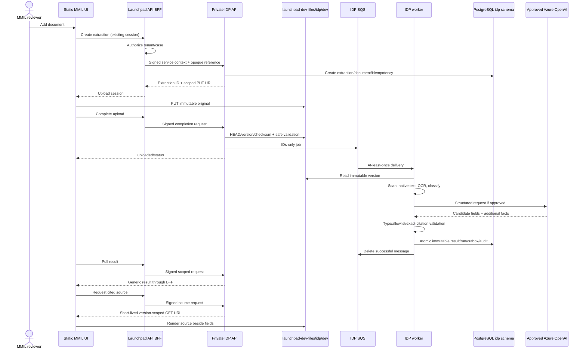

# Configurable IDP Engine Design

## 1. Overview

The reusable IDP engine is a private, multi-tenant microservice. Consumers submit an opaque business reference and document. IDP controls storage identity, asynchronous processing, classification, versioned extraction, additional-fact capture, grounding, and result serialization. It has no knowledge of MMIL underwriting cases or UI workflow.

The static MMIL page is an adapter. It maps the medical contract to cards and shows source citations. Browser authentication and MMIL authorization remain in the existing Launchpad API BFF.

### Design choices

- **BFF in front of private IDP:** The deployed Cognito app client is confidential. A static SPA cannot safely hold its secret. The current Launchpad API therefore keeps browser/session authorization and signs a short-lived service context for IDP.
- **Dedicated IDP queue/services/roles:** Reusing an unrelated Launchpad queue or broad worker task role would couple message contracts and violate least privilege.
- **Shared data-plane resources:** Reuse the VPC/NAT/endpoints, KMS key, files bucket, RDS instance, CloudFront/WAF, and bootstrap. Add an IDP prefix/schema/role rather than a second platform.
- **Container OCR in dev:** Supplied roles do not permit Textract. PyMuPDF plus RapidOCR runs in the IDP worker at one-document concurrency and 1 vCPU/2 GB until benchmarked.
- **Azure OpenAI only when approved:** The only supplied model secret is OpenAI/Azure. Bedrock/Claude is not an active dev adapter. No fallback is allowed.
- **Primary fields plus additional facts:** Stable configured fields support integrations; bounded grounded additional facts capture explicit content outside the current schema without silently changing the contract.

## 2. Architecture



## 3. Component boundaries

### 3.1 IDP API

Responsibilities:

- Validate service context and consumer policy.
- Create extraction/upload identities and idempotency mappings.
- Generate/verify scoped S3 operations.
- Enqueue opaque jobs.
- Return status/result/type registry metadata.
- Issue source URLs.
- Never run OCR/model extraction in an HTTP request.

The API task does not receive the model API key.

### 3.2 IDP worker

Responsibilities:

- Lease/consume only the IDP queue.
- Verify immutable content hash before each run.
- Execute scanner, native text, OCR, classifier, extraction provider, normalization, grounding, and persistence.
- Extend SQS visibility and checkpoint stages.
- Persist an outbox/audit event in the same DB transaction as result state.
- Never accept consumer-supplied endpoint, model, schema, callback, object key, or tool configuration.

### 3.3 Document registry

The registry loads immutable definitions by `(document_type, schema_version, checksum)`. MVP definitions can be packaged in the image and seeded into PostgreSQL by migration. Runtime activation reads DB metadata but immutable definition content remains checksum-verified. A future administrator service may manage drafts, but workers process only approved active versions.

### 3.4 Provider gateway

```python
class ExtractionProvider(Protocol):
    provider_id: str
    deployment_id: str

    def extract(self, request: ProviderExtractionRequest) -> ProviderExtractionResponse: ...
```

`ProviderExtractionRequest` contains:

- pinned document type/schema/checksum/prompt version;
- field paths, types, descriptions, units, and requiredness;
- allowed additional-fact categories/max items;
- page-numbered untrusted text and optional approved page images;
- no object URLs, credentials, tenant/user data not required by the document, callbacks, or tools.

Adapters:

- `deterministic-local`: tests/dev fallback; pattern extraction only; model version `not-applicable`.
- `azure-openai`: Launchpad dev candidate once approved; HTTPS endpoint/deployment/API version/region pinned from deployment configuration; key from Secrets Manager.
- Future adapters require explicit code, IAM/network/data approval and their own contract tests. They are not selected through request input.

### 3.5 OCR gateway

```python
class PageTextExtractor(Protocol):
    def extract(self, document: ImmutableDocument) -> list[PageText]: ...

class OcrAdapter(Protocol):
    def extract(self, raster: RasterPage) -> OcrPage: ...
```

- PyMuPDF supplies native text/blocks and safe page rasterization.
- RapidOCR supplies dev OCR. Pin ONNX model/package digest in the worker image.
- Every page records engine, version, confidence, width/height, and whether OCR was used.
- Textract is not constructed in Launchpad dev configuration because no supplied role permits it.

### 3.6 Launchpad BFF adapter

The BFF remains thin:

```python
class IdpClient:
    create_extraction(context, request) -> UploadSession
    complete_extraction(context, extraction_id) -> Status
    get_status(context, extraction_id) -> Status
    get_result(context, extraction_id) -> IdpResult
    create_source_url(context, extraction_id) -> SourceGrant
```

It authorizes the MMIL case, converts the case identifier to an opaque external reference, signs service context, and forwards the response. It must not run prompts, normalize values, manufacture citations, or duplicate result persistence.

## 4. Service-context contract

Use a dedicated asymmetric service JWT where platform key management supports it; otherwise use a rotated HMAC secret in Secrets Manager for dev only. Claims:

```json
{
  "iss": "launchpad-api",
  "aud": "idp-api",
  "consumer_id": "mmil",
  "tenant_id": "tenant-opaque-id",
  "sub": "cognito-sub-or-service-subject",
  "permissions": ["extraction:create", "extraction:read", "source:read"],
  "external_reference": "opaque-case-reference",
  "iat": 0,
  "exp": 0,
  "jti": "nonce",
  "correlation_id": "uuid"
}
```

- Maximum lifetime: 5 minutes in dev, shorter where possible.
- Clock skew: bounded and monitored.
- IDP validates every claim and DB resource ownership.
- For mutation requests, use idempotency plus optional `jti` replay cache/table.
- IDP strips/ignores `X-Demo-*`, tenant, role, and reference headers from untrusted callers in deployed mode.
- Network SG restriction supplements but never replaces signature/authorization.

## 5. API contract

Base path: `/api/v1/idp`.

### Create extraction

`POST /extractions`

```json
{
  "external_reference": "opaque",
  "requested_document_type": "medical_report",
  "file": {
    "display_filename": "report.pdf",
    "media_type": "application/pdf",
    "size_bytes": 12345,
    "sha256": "optional-client-checksum"
  }
}
```

Header: `Idempotency-Key`.

Response `201`:

```json
{
  "extraction_id": "uuid",
  "document_id": "uuid",
  "status": "uploading",
  "upload": {
    "method": "PUT",
    "url": "redacted-from-logs",
    "required_headers": {"Content-Type": "application/pdf"},
    "expires_at": "..."
  }
}
```

### Complete upload

`POST /extractions/{id}/complete`

Request identifies returned S3 version/checksum where needed. IDP performs HEAD, reads bounded source for signature/parser validation, then queues.

### Status

`GET /extractions/{id}` returns safe stage/timestamps/attempt/failure/classification metadata but no page text.

### Result

`GET /extractions/{id}/result` returns `409 result_not_ready` until atomically published. It returns the document-specific envelope in `plan.md` when ready.

The authoritative flat field contract:

```json
{
  "path": "labs.hba1c",
  "label": "HbA1c",
  "data_type": "decimal",
  "source_literal": "5.4",
  "value": 5.4,
  "unit": "%",
  "status": "found",
  "confidence": 0.96,
  "validations": [],
  "citations": [
    {
      "document_id": "uuid",
      "document_version": 1,
      "page": 4,
      "excerpt": "HbA1c: 5.4 %",
      "bbox": {"x0": 0.1, "y0": 0.2, "x1": 0.3, "y1": 0.24}
    }
  ]
}
```

Additional facts use the same grounding fields plus `id`, `name`, and allowlisted `category`. They are intentionally not addressable as stable primary JSON paths across schema versions.

### Source URL

`POST /extractions/{id}/source-url` returns a five-minute URL for the exact original object version. The API response is `no-store`; URL/query is never logged.

### Errors

Use `application/problem+json` with safe code/correlation ID. Important codes:

- `invalid_service_context`, `consumer_forbidden`, `extraction_not_found`
- `idempotency_conflict`, `upload_not_found`, `upload_version_mismatch`, `checksum_mismatch`
- `file_too_large`, `unsupported_media_type`, `signature_mismatch`, `encrypted_document`, `page_limit_exceeded`, `pixel_limit_exceeded`, `malware_detected`
- `classification_uncertain`, `type_selection_required`, `unsupported_document_type`
- `ocr_unavailable`, `ocr_resource_limit`, `provider_not_approved`, `provider_throttled`, `provider_unavailable`, `invalid_provider_output`
- `citation_missing`, `citation_invalid`, `result_not_ready`, `document_not_retryable`

No error contains source text, model output, filenames, object paths/URLs, SQL, or secrets.

## 6. Configuration model

```python
class DocumentTypeDefinition(BaseModel):
    document_type: Identifier
    schema_version: SemVer
    display_name: str
    classification: ClassificationPolicy
    constraints: FileConstraints
    extraction: ExtractionPolicy
    fields: list[FieldDefinition]
    additional_facts: AdditionalFactPolicy

class FieldDefinition(BaseModel):
    path: DottedPath
    label: str
    description: str
    data_type: DataType
    unit: str | None
    required: bool
    citations_required: bool = True
    ui: UiHint
    normalizers: list[NormalizerId]
    validators: list[ValidatorId]
    deterministic_patterns: list[Pattern] = []
```

`ExtractionPolicy.strategy` values:

- `deterministic_only`
- `llm_with_deterministic_validation`
- `llm_only_with_grounding_validation`

The deployment/consumer policy may further restrict strategies. It cannot expand beyond an approved definition.

### Medical contract 1.0.0

Primary groups:

- Report: date, report/laboratory identifiers, observation/sample date.
- Subject: name/age/sex only when required and approved; avoid exposing unnecessary identifiers to consumers.
- Body measurements: height, weight, BMI.
- Vitals: systolic/diastolic BP, pulse, respiratory rate, temperature.
- Lifestyle/history: tobacco, alcohol, disclosed conditions, family history.
- Medication: names, dose, frequency, duration when explicit.
- Cardiac: resting ECG and TMT/stress result.
- Blood sugar: fasting glucose and HbA1c.
- Lipid: total cholesterol, LDL, HDL, triglycerides.
- Liver: AST/SGOT, ALT/SGPT and other configured markers.
- Kidney: creatinine, eGFR and other configured markers.
- Screening: HIV, HBsAg and configured tests.

No normal/reference range or medical category is invented. A range may be returned only if printed in the source or configured as explicitly approved metadata with its origin identified.

### Future type process

1. Create a new definition and prompt output schema.
2. Add de-identified/synthetic golden documents and field/fact labels.
3. Validate schema and prompt injection cases.
4. Measure classification, field quality, additional-fact relevance, and citation correctness separately.
5. Obtain document-domain/privacy approval.
6. Activate version/checksum for selected consumers.
7. Add only consumer display mapping; the engine pipeline remains unchanged.

## 7. Extraction pipeline

1. **Verify:** Resolve IDs to tenant/consumer-owned extraction and immutable S3 version; recheck SHA-256.
2. **Scan:** Invoke configured scanner. The repository's EICAR guard is local-only and production startup fails without an approved scanner.
3. **Text:** Use native PyMuPDF per page; OCR only low-text pages; retain blocks and versions.
4. **Classify:** Apply deterministic hints and configured model classifier among consumer-enabled types. Stop on uncertainty.
5. **Build contract:** Load exact active schema/checksum and prompt.
6. **Deterministic pre-pass:** Extract exact regex/table patterns where configured. Preserve candidates.
7. **LLM extraction:** Ask one approved deployment for configured candidates and bounded additional facts.
8. **Parse:** Reject unknown keys/categories, over-limit facts, invalid JSON/types, or hidden reasoning fields.
9. **Normalize:** Apply named deterministic normalizers; preserve literals and units.
10. **Ground:** Verify document/version/page/exact excerpt and bbox bounds. Values without evidence become absent/uncertain.
11. **Resolve duplicates:** Deduplicate same literal/citation; mark distinct singular values as conflicts.
12. **Persist:** Insert immutable run/pages/fields/facts/issues/outbox/audit and update terminal status in one DB transaction.
13. **Publish:** Delete SQS message only after commit; outbox updates metrics/events idempotently.

## 8. Data model

### Consumer

- `id`, `name`, `enabled`, `service_audience`
- tenant/consumer policy references, enabled document types, quotas
- timestamps/version

### ExtractionRequest

- `id`, `consumer_id`, `tenant_id`, `external_reference_hash/encrypted_value`
- requested/detected document type and classification state/confidence
- `status`, safe failure code, correlation ID
- created/updated/completed timestamps

### Document

- `id`, `extraction_id`, immutable version
- generated S3 key + S3 version ID
- encrypted display filename, media type, bytes, SHA-256, pages
- quarantine/clean state, retention class

### UploadIdempotency

- consumer/tenant/key hash, request-content fingerprint
- extraction/document ID, created timestamp
- unique consumer/tenant/key

### ProcessingJob

- extraction/document IDs, current stage, attempts/max, available time
- SQS message/receive metadata as opaque IDs, lease expiry
- stage timestamps and safe failure code

### DocumentTypeDefinition

- type, semantic version, checksum, lifecycle state
- immutable definition JSON, prompt reference/checksum, evaluation artifact reference
- actor/time for lifecycle transitions

### ExtractionRun

- extraction/document/config IDs and versions
- text/OCR/classifier/provider/deployment/prompt/output-schema versions
- status, latency, token/cost metrics, correlation ID

### DocumentPage

- run/document/page number, sensitive text/blocks
- dimensions, engine/version, OCR flag/confidence

### ExtractedField

- run ID, configured path/type/unit/UI hints
- literal, normalized JSON, status/confidence
- validations and citations

### AdditionalFact

- run-local ID, name, allowed category/type/unit
- literal, normalized JSON, status/confidence
- validations and citations
- optional link to a primary field for deduplication

### AuditEvent

- tenant/consumer/extraction/document/run IDs
- actor/service, action, outcome, correlation ID, allowlisted metadata, timestamp
- no values/text/filenames/URLs
- runtime INSERT/SELECT only; trigger blocks update/delete

`Case` and underwriting `EvidenceReview` are not core IDP entities.

## 9. Launchpad AWS design

### Stack ownership

```text
Launchpad-dev-Network   (reuse)
Launchpad-dev-Data      (reuse + exports/IDP secret/schema grants)
Launchpad-dev-Auth      (reuse existing BFF session path)
Launchpad-dev-Api       (add thin BFF client + SG/secret grant)
Launchpad-dev-Idp       (new API/worker/queue/DLQ/roles/discovery/logs/alarms)
Launchpad-dev-Web       (reuse; deploy static MMIL bundle)
Launchpad-dev-Waf       (reuse unchanged)
```

### IDP service resources

- New cluster `launchpad-dev-idp` in imported VPC.
- API one task at 0.5 vCPU/1 GB.
- Worker one task at 1 vCPU/2 GB, desired count one, concurrency one.
- IDP queue/DLQ encrypted by existing key; redrive at three receives.
- Private service discovery; IDP API ingress only from Launchpad API SG.
- Existing files bucket IDP prefix; no direct broad bucket grant.
- Existing RDS instance, new schema/role/secret; small connection pools.
- Separate log groups/alarms.
- `ContainerImage.fromAsset`, no direct ECR login.

### Missing integration inputs

The local workspace lacks the owning CDK source and generated identifiers. Implementation must not guess:

- VPC and private-egress subnet IDs;
- Launchpad API and RDS SG IDs;
- RDS endpoint/master-secret ARN;
- KMS key ARN;
- exact generated app DB/session/client secret ARNs;
- cluster/task definitions if the BFF is changed in place;
- Cloud Map namespace if present.

Prefer direct construct references in the owning monorepo. Otherwise use reviewed CloudFormation exports/context. Do not rely on shell SSM reads because the deploying user is denied SSM.

## 10. Security controls

- **Network:** IDP private; SG source restriction; RDS isolated; endpoint use for AWS services; Azure egress via NAT is the only external path.
- **Identity:** signed service context plus DB ownership check; static UI cannot assert tenant/roles directly.
- **Storage:** SSE-KMS/versioning/TLS/public block; generated keys; version-scoped URLs; no raw bucket URLs in stable results.
- **Queues:** IDs only, KMS, dedicated queue/DLQ, bounded replay.
- **Files:** signature/mime/extension, encryption/corruption, page/pixel/decompression/time/temp limits, approved scanner, parser isolation.
- **Models:** explicit approval flag, endpoint/deployment/region allowlist, secret injection to worker only, no tools/fallback/redirect, strict output, citation checks.
- **Telemetry:** structured allowlisted fields; no file names, references, values, excerpts, payloads, URLs, tokens, or secrets.
- **Database:** separate role/schema; parameterized SQL/ORM; audit immutability; migration master-secret isolation.
- **Consumer safety:** extraction only; no diagnosis/underwriting/coverage action.

## 11. Error handling and recovery

| Failure | Behavior |
|---|---|
| Invalid BFF context | Non-enumerating 401/404; no DB/object metadata. |
| Upload metadata/object mismatch | Quarantine remains; no SQS message; safe terminal code. |
| Duplicate complete/delivery | Return existing stage/result; no duplicate run. |
| Worker crash | Visibility expires; next worker resumes from DB checkpoint. |
| OCR resource error | Retry only if transient; otherwise explicit failed/uncertain per config. |
| Classification uncertainty | `type_selection_required`; no arbitrary extraction. |
| Provider throttle/outage | Bounded retry; no fallback. |
| Malformed/ungrounded model output | Reject item/run according to atomic policy; unsupported data never published. |
| DB commit failure | Do not delete SQS message; retry idempotently. |
| S3/RDS divergence | Reconciliation job compares immutable object/version and DB/outbox state. |
| DLQ | Alarm; redacted inspection; audited bounded replay after cause is fixed. |

## 12. Correctness properties

### Property 1: Consumer/tenant isolation

For every pair of distinct consumers, tenants, or external references, changing an extraction/document ID cannot return status, result, or source URL outside the signed service-context scope.

**Validates:** 1.4, 2.2–2.5, 12.4.

### Property 2: Upload identity and idempotency

For every supported byte stream, repeated same-key/same-fingerprint requests produce one extraction/document. Any different fingerprint under that key conflicts and leaves the first mapping/object unchanged.

**Validates:** 3.1–3.5.

### Property 3: Queue payload privacy

For every generated filename/reference/page text/value and queued job, the serialized SQS body contains only the declared message version and opaque IDs/correlation ID and contains none of the generated sensitive markers.

**Validates:** 4.1, 13.3.

### Property 4: Legal lifecycle

For every source/target state pair, the transition service accepts exactly the defined graph. Duplicate delivery at any stage cannot create a second run with the same logical run key.

**Validates:** 4.2–4.5.

### Property 5: Registry immutability

For every activated definition, changing any byte changes the checksum and cannot affect a run pinned to the prior checksum/version.

**Validates:** 5.2–5.4.

### Property 6: Classification uncertainty

For generated score vectors, extraction starts only when the top score meets the configured minimum and separation policy or when an authorized compatible type was explicitly selected.

**Validates:** 6.1–6.4.

### Property 7: Grounded output

For every non-null primary field or additional fact, at least one citation references the same document version, a page in range, and an excerpt exactly contained in retained page text. Mutation/removal of any citation component prevents publication.

**Validates:** 8.1–8.6, 9.1–9.5.

### Property 8: Additional-fact bounds and deduplication

For every provider response, published additional facts use only allowed categories, never exceed the configured maximum, and do not duplicate an equivalent primary field/literal/citation tuple.

**Validates:** 5.1, 8.3, 8.4, 8.6.

### Property 9: Provider is closed by configuration

For every endpoint/deployment/region/provider not in the approved deployment policy, construction fails before page text is serialized or transmitted. A request cannot override provider settings.

**Validates:** 10.1–10.5.

### Property 10: Result determinism and lineage

For every persisted result, flat primary fields can rebuild nested `data`, and each item resolves to document hash/version, page, run, config checksum, OCR/classifier/provider/deployment/prompt versions.

**Validates:** 9.3–9.5, 11.1–11.3.

### Property 11: Telemetry redaction

For every generated sensitive marker in filenames, references, text, values, excerpts, model payloads, URLs, and secrets, ordinary logs/metrics/traces/tags/audit/queue bodies contain no marker.

**Validates:** 13.1–13.4.

### Property 12: Configuration-only extension

Given a valid new document definition and fake provider output, the same unmodified pipeline classifies, extracts, validates, persists, and serializes its fields/facts.

**Validates:** 5.5, 14.1–14.4.

## 13. Testing strategy

### Unit/property

- Service-context signature/expiry/audience/scope/replay.
- S3 key generation and pre-sign restrictions.
- Signatures, parser/page/pixel/checksum limits.
- Idempotency and status graph.
- Registry schema/checksum/lifecycle and breaking-change policy.
- Classification thresholds.
- Native/OCR page provenance.
- Structured model parser, field/category allowlist, bounds, dedupe, normalization, exact grounding.
- Nested result construction and historical reproducibility.
- Redaction against marker-based generated data.

### Integration

- S3-compatible upload completion → queue → worker → DB/result.
- Duplicate SQS delivery, visibility extension, crash/restart, retry/DLQ/replay.
- PostgreSQL grants and audit trigger.
- Azure fake/contract server timeout/throttle/malformed output; no live PHI calls in CI.
- BFF signed context and cross-tenant/reference denial.
- Short-lived source URL method/version/expiry.

### Golden evaluation

Per document type and field:

- classification precision/recall/confusion;
- extraction precision/recall;
- citation page/excerpt correctness;
- additional-fact relevance, completeness, duplication, and category accuracy;
- native/scanned/rotated/table/multilingual/adversarial coverage;
- model/prompt/OCR/config regression by pinned version.

### MMIL consumer

Contract fixtures render medical fields and facts, not-found/uncertain/conflicts, polling/failure/retry, document selection, side-by-side citation page, mobile switch, and keyboard/accessibility states. UI tests never duplicate extraction logic.

## 14. Migration from the current prototype

The current repository prototype combines a seeded MMIL `Case`, direct multipart upload, local queue/storage, extraction, review, and UI. Migration occurs in safe increments:

1. Add this generic result/configuration contract and additional-fact persistence behind existing tests.
2. Introduce `Consumer` and `ExtractionRequest`; make `Document` reference extraction, not MMIL case.
3. Add generic `/api/v1/idp` endpoints while keeping case routes as a temporary adapter.
4. Change the frontend API module to consume generic/BFF routes and map external reference client-side.
5. Move human review/audit presentation records to the MMIL adapter boundary; retain IDP processing audit.
6. Add S3/SQS/PostgreSQL adapters and signed service context; keep local adapters for tests.
7. Remove transitional case routes/models only after consumer contract tests pass.

At no step may an old extraction lose its immutable source/run/citation lineage.
