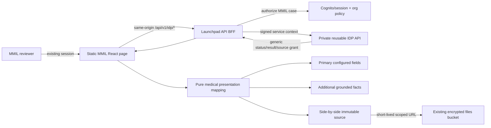

# MMIL Medical Evidence Consumer Design

## 1. Overview

The MMIL page is a static React/TypeScript presentation adapter for the reusable IDP result. The generic engine design is in `../configurable-idp-engine/design.md`.

The page retains the reference mock's brand header, case header, progress strip, compact cards, blue medical sub-tabs, and side panel. It removes all mock business actions and all extraction/review persistence. The Launchpad API BFF provides authorized case context and proxies the IDP contract. The browser never calls the private IDP API directly.

## 2. Architecture



## 3. Consumer API boundary

The frontend calls only BFF routes:

```typescript
interface IdpConsumerApi {
  createExtraction(fileMetadata: FileMetadata): Promise<UploadSession>;
  completeExtraction(extractionId: string, uploadReceipt: UploadReceipt): Promise<IdpStatus>;
  getStatus(extractionId: string): Promise<IdpStatus>;
  getResult(extractionId: string): Promise<IdpResult>;
  retryExtraction(extractionId: string): Promise<IdpStatus>;
  createSourceGrant(extractionId: string): Promise<SourceGrant>;
}
```

The BFF derives tenant, consumer, user, permissions, and opaque external reference from its authorized session/case context. The frontend does not submit trusted identity headers.

The page validates the returned API/document-contract major versions before mapping. Additive fields remain compatible.

## 4. UI layout

```text
┌──────────────── existing MMIL static header / environment ────────────────┐
├──────── authorized case display context ───────── Add document | Source ─┤
├──────────────────────── IDP processing progress ──────────────────────────┤
├ Summary | Vitals & BMI | Lab Results | Configured Checks | Extraction ──┤
│ Evidence and additional facts              │ Uploaded source document    │
│ value · unit · state · confidence           │ exact immutable version     │
│ citation controls                           │ page controls + excerpt      │
└─────────────────────────────────────────────┴──────────────────────────────┘
```

### Views

- **Summary:** selected configured medical fields and overall IDP status counts.
- **Vitals & BMI:** raw configured measurements only. No computed medical category or gauge threshold unless separately approved as presentation metadata.
- **Lab Results:** grouped configured values and source-printed reference ranges only.
- **Configured Checks:** IDP extraction/type/citation validation issues. No underwriting knockout logic.
- **AI Extraction Summary:** classification, schema/checksum, OCR/provider/deployment/prompt versions, completeness, uncertainty/conflicts, latency/cost metadata permitted for the role.
- **Additional Facts:** explicit source-backed facts outside the stable primary contract, visibly labelled as run-local.

Every value is rendered from `IdpResult.fields` or `additional_facts`. MMIL case data cannot fill a missing IDP field.

## 5. Side-by-side source viewer

State:

```typescript
interface SourceSelection {
  extractionId: string;
  documentId: string;
  documentVersion: number;
  page: number;
  excerpt: string | null;
  fieldOrFactId: string | null;
  grant: { url: string; expiresAt: string } | null;
}
```

Behavior:

1. Citation selection updates exact document/version/page/excerpt.
2. If no valid unexpired grant matches the version, request one from BFF.
3. Render PDF in a constrained same-origin/permitted-origin frame or JPEG/PNG image. TIFF/unsupported browser formats use authorized download.
4. Never store or log the grant URL. Keep it only in component memory and clear it on case/extraction change, logout, or expiry.
5. Desktop uses persistent split view. Mobile uses an explicit Evidence/Source switch.
6. Page hash navigation is best-effort; the visible toolbar always identifies the cited page and excerpt.

## 6. Static mapping model

```typescript
interface IdpResult {
  apiVersion: string;
  extractionId: string;
  externalReference: string;
  status: string;
  document: ImmutableDocumentSummary;
  classification: ClassificationResult;
  contract: DocumentContract;
  data: Record<string, unknown>;
  fields: IdpField[];
  additionalFacts: IdpFact[];
  issues: IdpIssue[];
  run: IdpRun;
}
```

A mapping registry converts stable field paths and optional IDP UI hints to view/group/order. It does not transform values beyond safe display formatting. Unknown additive fields/facts go to an **Other extracted details** section. Unknown major versions show an unsupported-contract state.

Additional facts linked to a primary field are shown once, with a badge indicating source linkage. Facts are never written back or promoted by the static client.

## 7. State and caching

- Case display context comes from the BFF and is separate from IDP result state.
- Extraction ID may be held in route/query/application memory according to existing Launchpad conventions; no source text/result is persisted in local/session storage.
- Poll active status with bounded backoff and stop on terminal state/unmount.
- API/result responses use `no-store`.
- Source grants stay in memory only and are refreshed after expiry.
- Changing case clears extraction/result/source state before loading the next authorized context.

## 8. Error handling

| IDP/BFF condition | UI behavior |
|---|---|
| Session/case denied | Generic access/not-found page; no direct retry against IDP/S3. |
| Upload validation | Safe file-specific message from mapped error code. |
| Processing active | Progress stage/live announcement; bounded polling. |
| Classification uncertain | Ask user to select among BFF/IDP-returned enabled types if permitted. |
| OCR/provider transient failure | Show safe status and server-authorized retry. |
| Result not ready | Continue bounded polling; do not show stale/default fields. |
| Unknown additive field/fact | Show in generic extracted-details section or documented safe fallback. |
| Unsupported major contract | Explicit unsupported-contract state; no value mapping. |
| Source grant expired | Request a fresh grant after reauthorization. |
| Source preview unsupported | Offer scoped download; do not embed active content. |

## 9. Privacy and security

- No third-party fonts, scripts, analytics, or error services receive case/extraction data.
- Do not put extracted values, filenames, excerpts, IDs, or source URLs in page title, browser URL, analytics, console logs, or ordinary exceptions.
- Use text rendering, not raw HTML, for document-derived strings.
- Static CSP comes from existing CloudFront headers and must permit only the exact API/S3 viewer paths.
- The SPA has no Cognito client secret, service-auth secret, model key, AWS key, or DB credential.
- The page is read-only. Human review controls and persistence are removed until a separate MMIL-owned spec is approved.

## 10. Accessibility and responsive behavior

- Semantic page landmarks, headings, tabs, status/live regions, tables, and labelled document controls.
- Keyboard operation for upload, views, citations, source selection/page/download, and close.
- Visible focus and state text independent of color.
- Focus returns to the citation/source trigger when a modal/drawer closes.
- Below the mobile breakpoint, Evidence and Source are mutually visible panels with equal content.
- Respect reduced motion.

## 11. Correctness properties

### Property 1: Pure result mapping

For every medical result fixture, every displayed extraction value/literal/unit/state/confidence/citation equals the corresponding IDP response value; changing MMIL case display data cannot change extraction output.

**Validates:** 1.2, 4.1–4.5, 7.4.

### Property 2: Missing-state preservation

For every `not_found`, `uncertain`, or `conflict` field, no mock/default/case value appears in its place.

**Validates:** 4.2–4.4.

### Property 3: Additional-fact distinction

For every fact list, linked primary duplicates render once, facts remain labelled run-local, and no fact becomes a primary field without a mapping/schema change.

**Validates:** 5.1–5.4.

### Property 4: Citation/source identity

For every field/fact citation, activation selects exactly its extraction/document/version/page/excerpt and obtains a matching unexpired grant.

**Validates:** 6.1–6.6.

### Property 5: Grant confidentiality

For every generated grant URL marker, browser storage, UI text, console/error telemetry, and application URLs contain no marker; component memory is cleared on context change/expiry.

**Validates:** 6.3, 7.1, 8.4.

### Property 6: Contract compatibility

Every additive `1.x` fixture renders known fields and safe unknown details; every unknown major version renders unsupported-contract state and never applies a wrong mapping.

**Validates:** 9.1–9.4.

## 12. Testing

- Contract fixtures for medical `1.0.0`, additive `1.x`, unsupported major, fields/facts/issues/run metadata.
- Empty/uploading/stage/failure/retry/classification-uncertain/result-ready states.
- Pure mapping and no-default substitution.
- Fact grouping/deduplication/unknown-category fallback.
- Citation → source grant/version/page/excerpt and expiry refresh.
- No review/edit controls or browser persistence.
- Keyboard/live-region/focus/responsive/reduced-motion tests.
- Production static build and existing CloudFront CSP compatibility.

## 13. Migration from the current UI prototype

1. Replace case-specific direct backend contracts with generated generic IDP/BFF types.
2. Remove review dialog/actions/counts and any review API calls from the static page.
3. Add Additional Facts and unsupported-contract views.
4. Replace direct content endpoint URLs with in-memory IDP source grants.
5. Keep the current visual components and responsive split layout.
6. Update tests so all extraction data comes only from IDP fixtures.
7. Deploy static assets to the existing Launchpad web bucket after BFF/IDP contract integration is available.
